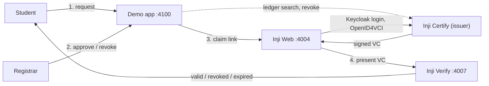
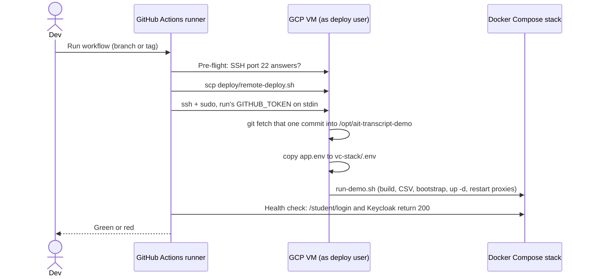

# AIT Transcript VC Journey

Local Docker-only walkthrough: student requests a transcript VC, registrar approves in the app, student claims into **Inji Web**, presents to **Inji Verify**. The same stack runs publicly on GCP, where the credential can also be claimed into the **Inji mobile wallet** (see [Developing an Inji-based mobile wallet](#developing-an-inji-based-mobile-wallet)).



Full service and port topology: [wiki/architecture/vc-stack.md](./wiki/architecture/vc-stack.md).

## Prerequisites

- Docker Desktop (Compose v2) — no host Python, `pip`, or `uvicorn`.
- `jq`, `curl`, `awk` on the host (used by the setup scripts, not just inside containers). `curl`/`awk` ship with macOS/Linux; `jq` may need `brew install jq`.
- **Windows:** run everything inside WSL2, not Git Bash — enable Docker Desktop's WSL integration, clone the repo into the WSL filesystem (not `/mnt/c/...`), and `sudo apt install jq` if it's missing. Git Bash mangles absolute paths in bind-mount arguments (e.g. the keystore step's `-v "$PWD/certs:/certs"`), which silently breaks the mount.

## Deploy locally

Run every command from the repo root, in WSL2 on Windows (see Prerequisites). The stack is four deployments, one folder each under `vc-stack/`, each with its own `compose.yaml`. Every folder file is `name: vc-stack`, so they all belong to one Compose project and share its network, volumes, keystore and DID.

| Folder | Containers | Host ports |
|---|---|---|
| `issuer/` | `database` (Postgres), `certify`, `certify-nginx`, `gateway`, `vdr` (the mock VDR) | 6440, 9090, 9091 |
| `mock-adapter/` | `adapter` (the mock data Adapter) | none |
| `verify/` | `verify-database`, `verify-service`, `verify-ui` | 9095, 4007 |
| `demo/` | `demo-database`, `mimoto-service`, `inji-web`, `keycloak-server`, `keycloak`, `public-gateway`, `demo-app` | 9099, 4004, 9080, 9098, 4100 |

Two top-level files pull the folders in with `include:`:

- `vc-stack/compose.yaml`: all four folders, the whole journey.
- `vc-stack/issuer-dev.yaml`: `issuer/` and `mock-adapter/`, the Issuer alone.

What each service is configured with, and which values a deployment replaces, is in [the configuration contract](./wiki/project/issuer-v0.1/configuration-contract.md); this README does not repeat it. How the folders fit together is in [wiki/architecture/vc-stack.md](./wiki/architecture/vc-stack.md).

### Choose an Installation

An Installation is a directory under `installations/` (`ait` issues the transcript, `hackathon` issues the Developer Passport and the Achievement). Name it with `INSTALLATION` in the environment, or in `vc-stack/.env`. The scripts stop before any container starts when it names no directory, and `bootstrap.sh` writes the value it ran with into `vc-stack/.env`. Certify's seed runs only on a fresh database, so switching to another Installation needs a reset (below).

### The whole stack

```sh
chmod +x run-demo.sh vc-stack/bootstrap.sh vc-stack/smoke.sh vc-stack/issuer-smoke.sh
INSTALLATION=ait ./run-demo.sh
```

`run-demo.sh` builds the demo app, adapter and gateway images, regenerates `installations/ait/adapter/student_identity_data.csv` from `data/students.json`, renders Mimoto's issuer list, builds the Certify plugin jar into `vc-stack/plugins/`, then runs `vc-stack/bootstrap.sh`, which brings the folders up in order and checks the result. A pass ends with `Stack is healthy.` and the URLs under [Accessing the demo locally](#accessing-the-demo-locally). Run it again whenever `data/students.json` changes, so the adapter CSV stays in sync.

After the first run has written `vc-stack/.env` and created the Docker network, the plain Compose form works too (it needs the plugin jar and the CSV `run-demo.sh` made):

```sh
mkdir -p .demo-state
docker compose -f vc-stack/compose.yaml up -d --build
```

### The Issuer alone

`vc-stack/issuer-dev.yaml` runs the Issuer and the mock Adapter, with no Keycloak, wallet or verifier. It is what the dev server runs until a real Adapter serves credential data.

```sh
export INSTALLATION=ait                     # or hackathon
./vc-stack/bootstrap.sh --prepare           # writes vc-stack/.env, creates the Docker network, starts nothing
python3 data/generate_csv.py                # ait only: the adapter CSV. The hackathon roster is committed
mkdir -p vc-stack/plugins/.m2
docker run --rm --user "$(id -u):$(id -g)" \
  -v "$PWD/gateway/plugin:/src" -w /src \
  -v "$PWD/vc-stack/plugins/.m2:/var/maven/.m2" -e MAVEN_CONFIG=/var/maven/.m2 \
  maven:3.9-eclipse-temurin-21 mvn -q -B -Duser.home=/var/maven package
cp gateway/plugin/target/gateway-data-provider-plugin.jar vc-stack/plugins/
docker compose -f vc-stack/issuer-dev.yaml up -d --build
./vc-stack/bootstrap.sh --did-refresh       # after every compose up: Certify's live did:key, the AIT context URL
```

Certify answers on `http://localhost:9091/.well-known/openid-credential-issuer` once it is up, and certify-nginx, the Issuer's single entry point, also serves the JSON-LD contexts from the mock VDR on `http://localhost:9091/contexts/`; [How to test](#how-to-test) has the smoke that checks it.

`--did-refresh` does two things the plain `compose up` cannot:

- **The DID.** A fresh keystore holds a new signing key, and a `did:key` is that key, so Certify's DID is only known once Certify runs. `--did-refresh` reads it from `did.json`, writes it to every credential configuration and to `CERTIFY_DID` in `vc-stack/.env`, and recreates Certify. Until then Certify signs as the seed's placeholder, and every credential fails verification. It is safe to run again: with nothing to change it restarts nothing.
- **The context URL.** The `compose up` leaves the contexts at the seed's local URL, `http://host.docker.internal:9098/contexts/…`, which is the full stack's public gateway and does not exist here. `--did-refresh` moves the AIT row to `<CERTIFY_PUBLIC_BASE_URL>/contexts/transcript/v1.json` when `CERTIFY_PUBLIC_BASE_URL` in `vc-stack/.env` is `https` (the issuer-dev ingress, which sends `/contexts/` to certify-nginx), or to `STUDENT_CONTEXT_URL` when `.env` sets it; it does nothing for a local `http` base. It covers only the AIT row: the hackathon Installation's rows keep the seed's local URLs, so on issuer-dev Certify cannot load their contexts yet. Running one folder's own file (`vc-stack/issuer/compose.yaml`) needs `--env-file vc-stack/.env` as well, because the folder reads no `.env` of its own.

### Reset

```sh
INSTALLATION=ait ./run-demo.sh --wipe       # or: INSTALLATION=ait ./vc-stack/bootstrap.sh --wipe
```

`--wipe` removes the containers and volumes of the whole `vc-stack` project (every folder, since they share it), plus `vc-stack/certs/`, `vc-stack/data/` and `vc-stack/.env`, so the next bring-up has a new signing key and `did:key`. It then brings the full stack back up. No folder has a reset of its own. Use it to switch Installation too: `INSTALLATION=hackathon ./run-demo.sh --wipe`.

### Demo app persistence

Request/approval SQLite state lives at **`.demo-state/demo_requests.db`** on the host (bind-mounted into the container). It survives `docker compose restart demo-app` and `docker compose down` / `up`. Delete that file to reset workflow state.

### Developing the demo app

`portal/` and `data/` are **bind-mounted** into the container; `uvicorn` runs with **`--reload`**, so Python and template edits apply without rebuilding. Rebuild only when `portal/requirements.txt` changes:

```sh
docker compose -f vc-stack/compose.yaml build demo-app
docker compose -f vc-stack/compose.yaml up -d demo-app
```

The demo app calls Certify server-to-server (`ledger-search`, status list, revoke — see [wiki/concepts/vc-revocation.md](./wiki/concepts/vc-revocation.md)) but never Mimoto or Keycloak; for claiming and verifying it only renders links to **http://localhost:4004** and **http://localhost:4007** for the presenter’s browser.

## How to test

Every test is a plain script, not pytest. A script prints one `PASS <name>` line per test and a closing count (or `all tests passed`) and exits 0; a failure is a traceback and a non-zero exit status.

### Unit tests

None of these needs the stack up (the plugin test and `test_context_refresh.py` use Docker for a throwaway container). Install the host dependencies once (Python 3.11 or later), and render the issuer config that one test reads (a git-ignored file):

```sh
pip install -r portal/requirements.txt -r gateway/requirements.txt tzdata
INSTALLATION=ait python3 data/render_mimoto_issuers_config.py
```

| Module | Command | What a pass shows |
|---|---|---|
| Gateway | `python3 gateway/tests/test_credential_types.py` | each credential type's checklist and claim mapping |
| Gateway | `python3 gateway/tests/test_issuances.py` | `POST /issuances` against the mock Adapter in-process, for every type in every Installation's `smoke.json`: 200, 403 per failing check, 404 for the unknown persona, 502 for bad Adapter data |
| Adapter | `python3 adapter/test_adapter.py` | the mock Adapter on the generated CSV and on the hackathon roster, and `adapter/openapi.yaml` requiring every field a Gateway model requires |
| Plugin | `docker run --rm -v "$PWD/gateway/plugin:/src" -w /src maven:3.9-eclipse-temurin-21 mvn -q package` | needs Docker; prints nothing, exits 0, and leaves `gateway/plugin/target/gateway-data-provider-plugin.jar` |
| `vc-stack/` | `python3 vc-stack/test_installation_guard.py` | the scripts refuse a missing `INSTALLATION` |
| `vc-stack/` | `python3 vc-stack/test_installations.py` | each Installation's realm users match its adapter CSV, and its `smoke.json` personas are among them |
| `vc-stack/` | `python3 vc-stack/test_authorization_server.py` | Certify's properties and Mimoto's issuer list for the stand-in and the campus realm |
| `vc-stack/` | `python3 vc-stack/test_configuration_contract.py` | the configuration contract's tables match the folders' `compose.yaml` files |
| `vc-stack/` | `python3 vc-stack/test_issue_and_verify.py` | the smoke's token request, proof JWT and verify outcomes, HTTP mocked |
| `vc-stack/` | `python3 vc-stack/test_inji_web_vc_readiness.py` | the config behind Inji Web's download path |
| `vc-stack/` | `python3 vc-stack/test_context_refresh.py` | needs Docker: `context_refresh.sql` against a throwaway Postgres |
| Portal | `python3 portal/test_auth.py`, `python3 portal/test_requests.py` | the demo app's logic; also runnable inside the image: `docker compose -f vc-stack/compose.yaml run --rm --no-deps demo-app python portal/test_requests.py` |
| Data | `python3 data/test_ait_courses.py`, `data/test_generate_csv.py`, `data/test_render_mimoto_issuers_config.py` | the fixtures and generators |

### Smoke tests

A smoke test needs the stack up (see [Deploy locally](#deploy-locally)) with the same `INSTALLATION` in the environment or in `vc-stack/.env`. Each prints `OK: <check>` per check; a failure prints `FAIL: <reason>` and exits 1.

| Smoke | Stack | Command | A pass ends with |
|---|---|---|---|
| Issuer-only | `vc-stack/issuer-dev.yaml` up | `./vc-stack/issuer-smoke.sh` | `All Issuer-only smoke checks passed.` |
| Full stack | `vc-stack/compose.yaml` up | `./vc-stack/smoke.sh` | `All smoke checks passed.` |

- **Issuer-only** checks that Certify loaded the Gateway plugin and lists exactly the Installation's credential types with the Gateway's claims, that certify-nginx serves their contexts from the VDR, and that the Gateway answers every persona of `installations/<name>/smoke.json`: 200 for the eligible, 403 `checklist_failed` for the refused, 404 `no_record` for the unknown, and 502 `gateway_error` with the Adapter stopped. It issues no credential, because there is no Authorization Server.
- **Full stack** runs the Gateway checks directly and through Certify, and adds Mimoto, Keycloak and Inji Web configuration checks, a bootstrap re-run, `issue_and_verify.py` (issue each type with the Keycloak `smoke` client, verify it, then verify tampered copies and expect `ERR_SIGNATURE_VERIFICATION_FAILED`), and `test_inji_web_vc_readiness.py --live`. It runs only against the stand-in Keycloak, not a campus realm.

The browser OAuth login and the PDF download are still manual.

CI runs the host tests, then the full-stack smoke and the Issuer-only smoke once per Installation, each on a fresh runner (`.github/workflows/test.yml`).

## Deploying to GCP

The demo also runs as a public deployment on a GCE VM behind Caddy (TLS), reachable without any local setup. The VM, DNS and firewall are defined in [mosip-asia/ait-vc](https://github.com/mosip-asia/ait-vc) (`ait-vc-transcript-demo/`); this repo only holds the app and the deploy workflow.

The VM is off outside Mon-Fri 08:30-18:30 Asia/Bangkok; the workflow's pre-flight says so if you deploy then.

### GCP infrastructure

Everything below is defined in Terraform in [mosip-asia/ait-vc](https://github.com/mosip-asia/ait-vc), not in this repo. Two roots are involved: `ait-vc-mgmt/terraform` (the project envelope and the DNS zone) and `ait-vc-transcript-demo/terraform` (the workload).

| GCP service | What it does here | Terraform |
|---|---|---|
| **Resource Manager, Billing** | Project `ait-vc-transcript-demo`, billing link, deletion lien. Only the Compute and IAM APIs are enabled. | `ait-vc-mgmt`: `prj-transcript-demo.tf` |
| **Compute Engine: VM** | One `e2-standard-2` (Debian 12, 30 GB `pd-balanced`, Shielded VM) in `asia-southeast1-b` running the whole Docker Compose stack. Its startup script installs Docker, Caddy and Dozzle and restarts the stack on every boot. | `compute.tf`, `startup.sh.tpl` |
| **Compute Engine: instance schedule** | Starts the VM 08:30 and stops it 18:30, Mon-Fri Asia/Bangkok, to save cost. | `schedule.tf` |
| **VPC, static IP, firewall** | A dedicated VPC and subnet, a permanent static external IP, and firewall rules for ports 80/443 (web), 22 (key-only SSH for GitHub runners) and 22 via IAP. Container ports stay closed. | `network.tf` |
| **Cloud DNS** | A records for the apex and `*.` wildcard pointing at the static IP, in the zone owned by `ait-vc-mgmt`. | `dns.tf` |
| **IAM, OS Login, IAP** | The VM's service account holds no roles. Operators listed in `admin_users` get OS Login admin and IAP tunnel access. | `compute.tf` |
| **Cloud Storage** | Holds the Terraform state (`gs://ait-vc-dpi-ait-ac-th-tfstate`). Not used at runtime. | `backends.tf` |

Not GCP services, but on the VM: **Caddy** terminates TLS (automatic Let's Encrypt certificates) and blocks the admin paths, and **Dozzle** shows container logs behind basic auth.

Change the VM, schedule, network or DNS by editing that Terraform in the `ait-vc` repo. A change to this repo's code never touches them; it only needs a [deploy](#deploy-a-change).

### Deploy a change

A deploy is manual and ships exactly one commit; nothing on the VM pulls code by itself.



1. Push your branch to GitHub (`mosip-asia/ait-transcript`).
2. **Actions → Deploy → Run workflow**, choose the branch or tag.
3. The workflow logs in to the VM as `deploy`, runs `deploy/remote-deploy.sh` (fetch that commit into `/opt/ait-transcript-demo`, copy the VM's `app.env` to `vc-stack/.env`, run `run-demo.sh`), then health-checks `/student/login` and Keycloak's `openid-configuration`. Green means both returned 200.
4. Check the change on the [public URLs](#accessing-the-demo-on-gcp). Logs: Dozzle, or `docker logs <container>` over SSH.

## Accessing the demo locally

Inji Web student login uses **`http://localhost:9080`** (no `/etc/hosts` required); the Keycloak admin console is at `/admin/` on that host.

### Local URLs

| Service | URL |
|---|---|
| Student portal | http://localhost:4100/student/login |
| Registrar portal | http://localhost:4100/registrar/login |
| Inji Web | http://localhost:4004 |
| Inji Verify | http://localhost:4007 |
| Keycloak admin | http://localhost:9080/admin/ (admin / admin) |

### Stakeholder walkthrough

After `./run-demo.sh` (no further terminal steps):

1. Open **http://localhost:4100/student/login** → pick a student → **Request my transcript VC**.
2. Open **http://localhost:4100/registrar/login** → approve that request.
3. Reload the student tab → use **Claim your credential** → Inji Web → AIT University → **AIT Transcript** → Keycloak login.
4. Download/open the credential PDF — layout must match `design/pdf-ait-transcript-template.html` (presenter visual check).
5. From the student portal, open **Inji Verify** → present the credential → verification succeeds.
6. Repeat with a second student persona.

## Accessing the demo on GCP

**Availability:** the VM runs **Mon-Fri 08:30-18:30 Asia/Bangkok** and is off otherwise, so outside those hours the URLs time out.

### Public URLs

| Service | URL |
|---|---|
| Student portal | https://transcript-demo.ait-vc.dpi.ait.ac.th/student/login |
| Registrar portal | https://transcript-demo.ait-vc.dpi.ait.ac.th/registrar/login |
| Inji Web | https://wallet.transcript-demo.ait-vc.dpi.ait.ac.th |
| Inji Verify | https://verify.transcript-demo.ait-vc.dpi.ait.ac.th |
| API gateway (Certify, Mimoto, Verify, Keycloak realms) | https://api.transcript-demo.ait-vc.dpi.ait.ac.th |
| Keycloak (student logins, realm `inji`) | https://keycloak.transcript-demo.ait-vc.dpi.ait.ac.th |
| Container logs (Dozzle, basic auth) | https://logs.transcript-demo.ait-vc.dpi.ait.ac.th |

## Developing an Inji-based mobile wallet

The GCP deployment issues the transcript to the Inji mobile wallet as well as to Inji Web. It works with Inji Wallet **v0.22.1**, confirmed end to end on a physical iPhone through TestFlight (iOS only; Android is untried). The public hostnames, the one `MIMOTO_HOST` app setting, the issuer and credential values, the flow, what to watch for and the iOS build recipe are in [wiki/guides/wallet-developer-urls.md](./wiki/guides/wallet-developer-urls.md); why the phone must use the `api.` host and not `wallet.` is in [wiki/reference/inji-mobile-wallet.md](./wiki/reference/inji-mobile-wallet.md).

**Start from [wallet/](./wallet/README.md):** `BUNDLE_ID=... TEAM_ID=... ./wallet/apply.sh ios <dir>` clones Inji Wallet v0.22.1 and applies the AIT hosts, signing, build fixes and `SceneDelegate` from two small patches. Use a physical iPhone: v0.22.1 does not run in the iOS Simulator.

### Wallets that are not Inji Wallet

A generic OpenID4VCI wallet cannot connect to the platform yet: the only OAuth client is confidential, and the advertised token endpoint is not public. Nothing has been tested with a non-Inji wallet. What the platform exposes, what a wallet must support, the workaround that exists today and the changes needed are in [wiki/guides/other-openid4vci-wallets.md](./wiki/guides/other-openid4vci-wallets.md).

## Docs

- [wiki/OVERVIEW.md](./wiki/OVERVIEW.md) — architecture and gotchas
- [wiki/project/issuer-v0.1/configuration-contract.md](./wiki/project/issuer-v0.1/configuration-contract.md) — every service's variables, files and ports
- [wallet/README.md](./wallet/README.md) — the per-platform patches (`common/`, `ios/`) and one-command script that turn Inji Wallet v0.22.1 into the AIT-connected wallet
- [wiki/guides/wallet-developer-urls.md](./wiki/guides/wallet-developer-urls.md) — URLs, flow and iOS build recipe for Inji-based wallets
- [wiki/guides/other-openid4vci-wallets.md](./wiki/guides/other-openid4vci-wallets.md) — connecting a non-Inji OpenID4VCI wallet
- [wiki/reference/inji-mobile-wallet.md](./wiki/reference/inji-mobile-wallet.md) — why the phone gets its own views of the issuer list and metadata
