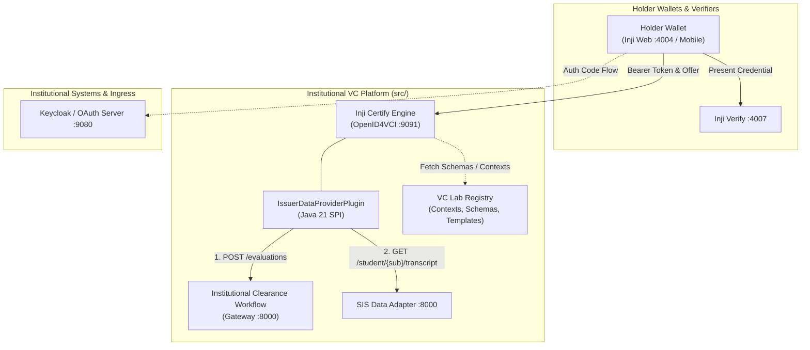
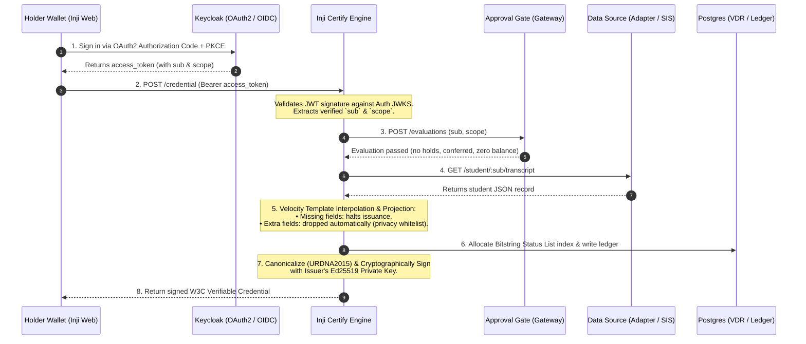
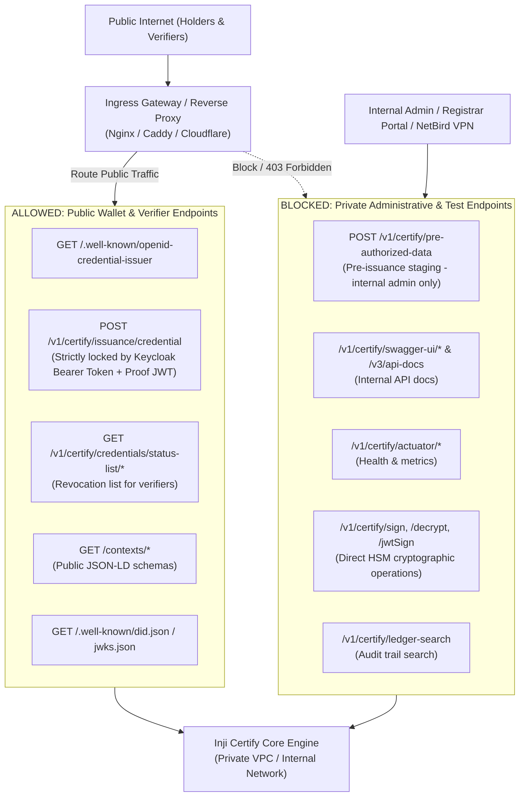

# Institutional Verifiable Credential Platform (AIT Issuer)

An enterprise Verifiable Credential (VC) platform built on **MOSIP Inji Certify**, issuing W3C VCDM 2.0 credentials (JSON-LD with Ed25519Signature2020) via OpenID4VCI.

The platform provides end-to-end credential lifecycle management: institutional clearance workflow, dynamic data resolution, cryptographic signing, credential design studio, and wallet issuance.



---

## 1. Repository Architecture

The codebase is organized into modular components separating pure source code, container packaging, and deployment orchestration:

```
ait-transcript/
├── src/                                  # 100% PURE APPLICATION SOURCE CODE
│   ├── issuer/                           # Java 21 SPI Data-Provider Plugin (pom.xml + src/)
│   ├── gateway/                          # Institutional clearance & permission workflow engine
│   ├── certify_template_sync/            # GitOps template synchronizer module
│   └── vc-lab/                           # VC Designer: W3C JSON-LD contexts, schemas, visual templates
│
├── config/                               # DECLARATIVE REPOSITORY CONFIGURATION
│   └── credentials/                      # Declarative JSON credential configurations (e.g. ait-transcript.json)
│
├── docker/                               # CONTAINER PACKAGING RECIPES
│   ├── Dockerfile.certify                # Bakes src/issuer SPI plugin into Inji Certify
│   ├── Dockerfile.gateway                # Packages src/gateway
│   └── Dockerfile.template-sync          # Packages certify_template_sync (uv + Alpine)
│
├── compose.yaml                          # Local developer platform compose (builds from src/)
├── compose.dev.yaml                      # Loop 3: Hot JAR mount dev overlay (~3s reload)
├── .env.example                          # Root developer environment configuration
├── pyproject.toml / uv.lock              # Modern Python dependency management (uv)
│
├── deploy/                               # DEPLOYMENT OVERLAYS & PLATFORM RUNTIME
│   ├── base/                             # Shared Inji platform defaults (properties, nginx, SQL)
│   ├── ait/                              # Academic Transcript tenant profile
│   ├── hackathon/                        # Developer Passport & Achievement tenant profile
│   ├── remote-deploy.sh                  # Automated VM deployment script used by CI/CD
│   └── smoke.sh                          # Headless OpenID4VCI issuance smoke test (pure bash)
│
└── vc-stack/                             # FULL DEMO STACK (Inji Web, Keycloak, Portal, Verify)
```

---

## 2. How Credential Issuance Works (Lifecycle & Data Flow)

Understanding the complete OpenID4VCI credential lifecycle requires four architectural pillars:

```
    1. Schema & Context              2. Authentication             3. Certify Blueprint              4. Data Source
      (`src/vc-lab/`)                 (OIDC / Keycloak)           (Postgres `credential_config`)      (SIS / Adapter)
  Public JSON-LD vocabulary       User logs in via OAuth2       Velocity `vc_template`, Key Alias,   Returns subject records
  defines terms & signature       provides verified `sub`       and W3C Bitstring Status List        via `CERTIFY_RECORD_URL`
```

### The 5-Step Issuance Pipeline



#### Detailed Pipeline Breakdown:

1. **Authentication & Identity Anchor:**
   - The holder signs into Keycloak. Certify verifies the Bearer JWT signature against Keycloak's JWKS endpoint (`AUTH_SERVER_JWKS_URL`).
   - Certify extracts the authenticated `sub` (student identifier) and requested `scope`. The user cannot query another person's record.

2. **Institutional Clearance Gate:**
   - When enabled, the DataProvider plugin calls Gateway (`POST /evaluations`).
   - The Gateway evaluates institutional clearance checks (holds, conferral status, tuition balance). Refusal fails closed.

3. **Data Retrieval:**
   - The plugin calls the configured upstream endpoint (`CERTIFY_RECORD_URL`), substituting `{sub}` with the token's identity.

4. **Template Resolution & Privacy Projection:**
   - Certify's internal Velocity engine loads the `vc_template` from `credential_config` matching the requested scope.
   - **Missing Fields:** If a template placeholder (e.g. `${fullName}`) is absent, template rendering fails and issuance halts.
   - **Extra Fields:** If the database returns additional attributes (e.g. `internal_db_id`, `motherName`), they are **silently dropped** because the template only renders explicit slots. The template acts as a privacy projection filter.

5. **Cryptographic Signing & Status List (VDR):**
   - **Status List Allocation:** Certify assigns an index in the W3C **Bitstring Status List** and logs an immutable audit row in `certify.ledger`.
   - **Cryptographic Proof:** The document is canonicalized into RDF triples (URDNA2015) and signed with the Issuer's private key (`Ed25519Signature2020`).
   - **Delivery:** The finalized W3C VC is delivered to the wallet. When Inji Verify checks the credential later, it fetches the public `@context` and verifies the status bit to ensure it has not been revoked.

### Testing APIs & Data Sources Without OAuth/VDR

If you only want to verify that your Data Source or Adapter is integrated successfully, you **do not need Keycloak, a wallet, or a VDR**.

#### 1. Interactive Swagger UI
Inji Certify includes an interactive Swagger UI for exploring and testing endpoints:
* **Swagger UI:** [http://localhost:9091/v1/certify/swagger-ui/index.html](http://localhost:9091/v1/certify/swagger-ui/index.html)
* **OpenAPI Spec:** [http://localhost:9091/v1/certify/v3/api-docs](http://localhost:9091/v1/certify/v3/api-docs)

#### 2. Official OpenID4VCI Pre-Authorized Code Flow (Headless Testing)
Official Inji Certify supports the **Pre-Authorized Code Flow** natively. Certify acts as its own token authority, allowing automated server-to-server issuance testing without human login:

```bash
# 1. Pre-authorize issuance for a student (creates credential offer):
OFFER_URI=$(curl -s -X POST http://localhost:9091/v1/certify/pre-authorized-data \
  -H "Content-Type: application/json" \
  -d '{"credential_configuration_id": "ait-transcript", "claims": {"registrationNo": "st125001"}}' \
  | jq -r .credential_offer_uri)

# 2. Extract offer ID and fetch the pre-authorized code:
OFFER_ID=$(echo "$OFFER_URI" | sed 's/.*credential-offer-data%2F//')
PRE_AUTH_CODE=$(curl -s "http://localhost:9091/v1/certify/credential-offer-data/$OFFER_ID" \
  | jq -r '.grants["urn:ietf:params:oauth:grant-type:pre-authorized_code"]["pre-authorized_code"]')

# 3. Exchange code for an Access Token directly with Inji Certify:
ACCESS_TOKEN=$(curl -s -X POST http://localhost:9091/v1/certify/oauth/token \
  -H "Content-Type: application/x-www-form-urlencoded" \
  -d "grant_type=urn:ietf:params:oauth:grant-type:pre-authorized_code&pre-authorized_code=$PRE_AUTH_CODE" \
  | jq -r .access_token)
```
This tests the full running Inji Certify engine, real database templates, DataProviderPlugin, and Data Source without external OAuth or VDR dependencies.

#### 3. One-Command Headless Issuance Smoke Test (`deploy/smoke.sh`)
To verify the complete issuer engine, GitOps template, and SIS connectivity end-to-end without Python or OAuth dependencies, run the included pure bash smoke test:

```bash
# Run smoke test for default student (st123456):
./deploy/smoke.sh

# Or test a specific student ID:
./deploy/smoke.sh st123457

# Target a remote deployment (e.g. over NetBird VPN):
./deploy/smoke.sh st123456 http://100.x.y.z:9091 ait-transcript
```

---

### Declarative GitOps Credential Configuration

Credential templates and configurations are managed natively as **GitOps declarative JSON artifacts** under `config/credentials/` (e.g. `config/credentials/ait-transcript.json`).

* **Human-Readable & Version-Controlled:** Templates are plain JSON files. No base64-encoded strings or manual SQL seed scripts.
* **Automatic Init Synchronization:** When executing `docker compose up -d`, the `template-sync` init container runs first, executing an idempotent SQL `UPSERT` into PostgreSQL (`ON CONFLICT (credential_config_key_id) DO UPDATE`) before `certify` boots.
* **Zero Downtime & Safe Updates:** Updating a template in Git only refreshes the `credential_config` table without wiping runtime signing keys (`key_store`), audit logs (`ledger`), or revocation lists (`status_list`).
* **Manual Sync / Dry Run:**
  ```bash
  # Dry-run inspect template changes:
  uv run certify-template-sync --dry-run

  # Apply changes directly to PostgreSQL:
  uv run certify-template-sync --apply

  # Or execute sync via Docker Compose:
  docker compose run --rm template-sync
  ```

> [!TIP]
> **Remote Access on GCP (NetBird VPN):**
> On the deployed GCP environment, port `9091` is closed to the public internet by the GCP cloud firewall. Authorized engineers, campus systems, and administrative batch scripts reach Swagger UI and the Pre-Authorized API directly over the **NetBird Zero-Trust Mesh VPN** (`http://<vm-netbird-ip>:9091/...`) without exposing unauthenticated endpoints publicly. See [Section 7: Deploying to GCP](#7-deploying-to-gcp).

---

### Security Architecture: Public vs. Private Ingress Boundary

Because Inji Certify serves both public wallet protocols and internal cryptographic/administrative endpoints, **Certify must never be exposed directly to the public internet without an ingress gateway (Reverse Proxy)**.



#### Why Student Records Cannot Be Stolen on the Public Path:
1. **Cryptographic Identity Anchor (No User-Supplied IDs):**
   On the public issuance endpoint (`/issuance/credential`), a caller cannot pass a `student_id` in the body. Inji Certify strictly reads the authenticated `sub` from the cryptographically signed Keycloak access token.
2. **Proof-of-Possession:**
   The wallet must sign a Proof JWT using its own private key bound to the ephemeral `c_nonce`. Stolen tokens cannot be replayed.
3. **Institutional Clearance Gate:**
   Certify queries the Gateway (`POST /evaluations`). If the student has holds, unpaid fees, or their degree is pending, issuance halts with `403 checklist_failed`.
4. **Pre-Authorized Endpoint Protection:**
   `POST /pre-authorized-data` allows creating issuance offers without human login for server-to-server batch jobs. **In production, this endpoint must be blocked at the ingress gateway** and accessible only via private network (NetBird VPN), campus VPC, or the Registrar Portal.

---

## 3. Prerequisites

- **Docker Desktop** (Compose v2) with Linux containers or WSL2 (on Windows).
- **Python 3.11+** and [`uv`](https://github.com/astral-sh/uv) (recommended for running tests and scripts).
- `jq`, `curl`, `awk` on the host.
- **Windows:** Run commands inside WSL2, not Git Bash, to avoid path-mangling issues on volume bind-mounts.

---

## 4. Deploy locally

Run every command from the repository root. Depending on your task, you can start the **Core Issuer Platform** (fast, focused) or the **Full End-to-End Demo** (with wallet, registrar portal, and verifier).

### Mode A: Core Issuer Platform (Developer Fast-Track)

Spins up the core Verifiable Credential Platform (`certify`, `certify-nginx`, `database`, `vdr`, and `template-sync` init container):

```bash
# 1. Setup local environment
cp .env.example .env

# 2. Build the SPI plugin via the compiler container (no host Maven/Java needed)
docker compose -f compose.build.yaml run --rm plugin-builder

# 3. Start the platform
docker compose up -d
```

#### Fast Inner Loops for SPI Plugin Development:
- **Compiler Container Build & Reload (~2s):**
  Recompile the JAR into `src/issuer/target/` and reload Certify without rebuilding the image:
  ```bash
  docker compose -f compose.build.yaml run --rm plugin-builder && docker compose restart certify
  ```
- **In-Memory Unit Tests (~3s):**
  ```bash
  cd src/issuer && mvn test
  # Or via Docker:
  docker run --rm -v "$PWD/src/issuer:/src" -w /src maven:3.9-eclipse-temurin-21 mvn test
  ```
- **Multi-Stage Production Image Build:**
  To build the standalone release image using the 2-stage Dockerfile:
  ```bash
  docker build -f docker/Dockerfile.certify -t ghcr.io/mosip-asia/ait-certify:local .
  ```

---

### Mode B: Full End-to-End Demo (Stakeholder Journey)

Brings up the complete multi-service demonstration journey (Inji Web Wallet, Keycloak OAuth Server, Registrar Portal, and Inji Verify):

```bash
chmod +x run-demo.sh vc-stack/bootstrap.sh vc-stack/smoke.sh vc-stack/issuer-smoke.sh
INSTALLATION=ait ./run-demo.sh
```

`run-demo.sh` prepares the database, generates mock student data, renders Mimoto issuer configurations, compiles the plugin JAR, brings up the containers in order, and verifies health. A successful start ends with `Stack is healthy.`

#### To Reset or Switch Installation:
```bash
INSTALLATION=ait ./run-demo.sh --wipe          # Reset AIT stack
INSTALLATION=hackathon ./run-demo.sh --wipe    # Switch to Hackathon profile
```

---

## 5. How to test

All test suites are automated and runnable locally on your host or in CI.

### Unit & Host Tests (Run without Docker)

Using `uv` (or `.venv`):

```bash
# Run all host verification tests:
uv run python data/test_generate_csv.py
uv run python vc-stack/test_installation_guard.py
uv run python vc-stack/test_installations.py
uv run python vc-stack/test_authorization_server.py
uv run python vc-stack/test_configuration_contract.py
uv run python adapter/test_adapter.py
uv run python src/gateway/tests/test_credential_types.py
uv run python src/gateway/tests/test_evaluations.py
uv run python sis-bridge/test_bridge.py

# Run Java plugin unit tests:
cd src/issuer && mvn test
```

| Module | Test Target | What It Verifies |
|---|---|---|
| **Gateway** | `src/gateway/tests/test_credential_types.py` | Credential clearance rules, hold checks, zero balance, conferral predicates |
| **Gateway** | `src/gateway/tests/test_evaluations.py` | In-process evaluation of `POST /evaluations` across all installation personas |
| **Issuer Plugin** | `src/issuer/` (`mvn test`) | SPI `fetchData()` contract, HTTP retry/timeouts, strict JSON escaping, trace keys |
| **Adapter** | `adapter/test_adapter.py` | Validates OpenAPI contracts (`adapter/openapi.yaml`) against VCDM 2.0 schemas |
| **Contract** | `vc-stack/test_configuration_contract.py` | Holds Compose files and architecture documentation in sync |
| **Auth Server** | `vc-stack/test_authorization_server.py` | Validates OIDC issuer URLs, Keycloak realm mappings, and public endpoints |

---

### Integration Smoke Tests (Requires Running Stack)

A smoke test verifies real cryptographic issuance, signature verification, and ledger recording.

| Smoke Suite | Pre-requisite | Command | Expected Output |
|---|---|---|---|
| **Issuer Smoke** | Core platform up | `./vc-stack/issuer-smoke.sh` | `All Issuer-only smoke checks passed.` |
| **Full Stack Smoke** | Demo stack up | `./vc-stack/smoke.sh` | `All smoke checks passed.` |

---

## 6. Local Access & Stakeholder Walkthrough

When running the Full Demo Stack (`./run-demo.sh`):

### Local Port Endpoints

| Service | Local URL | Role |
|---|---|---|
| **Student Portal** | [http://localhost:4100/student/login](http://localhost:4100/student/login) | Student requests transcript |
| **Registrar Portal** | [http://localhost:4100/registrar/login](http://localhost:4100/registrar/login) | Registrar approves or revokes issuance |
| **Inji Web Wallet** | [http://localhost:4004](http://localhost:4004) | Digital wallet to claim & store credentials |
| **Inji Verify** | [http://localhost:4007](http://localhost:4007) | Verifier to validate credential signatures & status |
| **Inji Certify** | [http://localhost:9091](http://localhost:9091) | OpenID4VCI credential issuer & metadata |
| **Inji Certify Swagger UI** | [http://localhost:9091/v1/certify/swagger-ui/index.html](http://localhost:9091/v1/certify/swagger-ui/index.html) | Interactive API exploration & Swagger testing |
| **Keycloak Admin** | [http://localhost:9080/admin/](http://localhost:9080/admin/) | Identity provider (`admin` / `admin`) |

### Stakeholder Walkthrough:
1. Open **Student Portal** ([http://localhost:4100/student/login](http://localhost:4100/student/login)) $\rightarrow$ Select `Nara Wattanakul` (`ait-2026-0001`) $\rightarrow$ Click **Request my transcript VC**.
2. Open **Registrar Portal** ([http://localhost:4100/registrar/login](http://localhost:4100/registrar/login)) $\rightarrow$ Sign in as Academic Registrar $\rightarrow$ Click **Approve**.
3. Return to Student Portal $\rightarrow$ Click **Claim your credential** $\rightarrow$ Redirects to **Inji Web**.
4. In Inji Web, sign in (`ait-2026-0001` / `inji`), select **AIT University**, and download the **AIT Transcript**.
5. Open **Inji Verify** ([http://localhost:4007](http://localhost:4007)) $\rightarrow$ Upload the downloaded credential JSON $\rightarrow$ Verdict reports **`allChecksSuccessful: true`**.

---

## 7. Deploying to GCP

The demonstration environment is continuously deployed to a Google Compute Engine VM (`ait-vc-transcript-demo`) behind Caddy (TLS) and NetBird Zero-Trust Mesh.

### Public Web Ingress (TLS / Caddy)

These public endpoints are internet-facing for student holders and external verifiers:

- **Student Portal:** `https://transcript-demo.ait-vc.dpi.ait.ac.th/student/login`
- **Registrar Portal:** `https://transcript-demo.ait-vc.dpi.ait.ac.th/registrar/login`
- **Inji Web Wallet:** `https://wallet.transcript-demo.ait-vc.dpi.ait.ac.th`
- **Inji Verify:** `https://verify.transcript-demo.ait-vc.dpi.ait.ac.th`
- **Issuer Metadata & Issuance:** `https://api.transcript-demo.ait-vc.dpi.ait.ac.th/.well-known/openid-credential-issuer` (routed via Caddy to `certify-nginx:8090`)

### Private Administrative & API Access via NetBird VPN

To protect sensitive administrative functions and pre-authorized issuance, internal ports are **never exposed to the public internet**:

- **GCP Firewall Policy:** Only inbound ports `80` and `443` are open to `0.0.0.0/0`. Direct engine ports (`9091` Certify, `8000` Adapter, `5432` PostgreSQL, `9080` Keycloak Admin) are blocked from public internet access.
- **NetBird Mesh Overlay:** The GCP VM joins the campus private NetBird WireGuard network (alongside campus infrastructure like `ait-itserv-vm.netbird.selfhosted`).
- **Zero-Trust Access:** Authorized administrators, engineers, and campus backend systems connected to NetBird access internal services directly using the VM's NetBird IP (`100.x.y.z`) or hostname without bastion hosts or SSH tunneling:
  - **Interactive Swagger UI:** `http://<vm-netbird-ip>:9091/v1/certify/swagger-ui/index.html`
  - **Pre-Authorized Issuance API:** `POST http://<vm-netbird-ip>:9091/v1/certify/pre-authorized-data`
  - **SIS Adapter Contract Verification:** `http://<vm-netbird-ip>:8000/student/{sub}/eligibility`
  - **Health & Actuator Metrics:** `http://<vm-netbird-ip>:9091/v1/certify/actuator/health`

This ensures that administrative pre-issuance and automated test harnesses remain fully functional remotely while strictly enforcing the public vs. private ingress boundary.

### Continuous Deployment

Deployments are triggered via GitHub Actions: **Actions $\rightarrow$ Deploy $\rightarrow$ Run workflow** (executes `deploy/remote-deploy.sh` on the VM).

---

## 8. Documentation & References

- [Architecture & Topology (`docs/architecture/vc-stack.md`)](./docs/architecture/vc-stack.md)
- [ADR 0001: Approval Gate Beside the Data Path](./docs/adr/0001-approval-gate-beside-the-data-path.md)
- [Inji Certify Standalone Deployment (`deploy/README.md`)](./deploy/README.md)
- [Gateway Workflow Engine (`src/gateway/README.md`)](./src/gateway/README.md)
- [VC Lab Designer (`src/vc-lab/README.md`)](./src/vc-lab/README.md)
- [Inji Mobile Wallet Guide (`wallet/README.md`)](./wallet/README.md)
