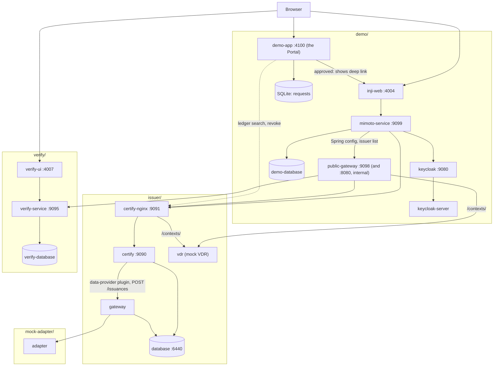

# Local Stack Architecture

`vc-stack/` in this repo vendors the same Docker Compose shape as `inji/vc-stack`, self-contained so this repo needs nothing else running. See [PRD.md §6.1.2](../../PRD.md) for the scope decision.

## Deployments

`vc-stack/` has one folder per deployment, each with its own `compose.yaml`. All of them are `name: vc-stack`, so one folder run alone is part of the same Compose project as the full stack and shares its volumes, keystore and DID. Mount sources (`config/`, `certs/`, `data/`, `plugins/`) stay in `vc-stack/`, so the keystore and DID survive whichever file is run. `docker compose -f vc-stack/<file> ...` reads `vc-stack/.env` by itself for a top-level file; a folder's own `compose.yaml` needs `--env-file vc-stack/.env`.

| Folder | Containers | Host ports |
|---|---|---|
| `issuer/` | `database` (Postgres, with Certify's schema and the `gateway` schema the Gateway creates), `certify`, `certify-nginx`, `gateway`, `vdr` (the mock VDR, which serves the Issuer's JSON-LD contexts) | 6440, 9090, 9091 |
| `mock-adapter/` | `adapter`, the mock data Adapter; a folder of its own because the Issuer-only run needs it until infra's Adapter serves credential data | none |
| `verify/` | `verify-database`, `verify-service`, `verify-ui` | 9095, 4007 |
| `demo/` | `demo-database` (Mimoto's Postgres), `mimoto-service`, `inji-web`, `keycloak-server`, `keycloak` (its nginx), `public-gateway`, `demo-app` | 9099, 4004, 9080, 9098, 4100 |

| Top-level file | Includes | Used for |
|---|---|---|
| `vc-stack/compose.yaml` | all four folders | the whole journey; `run-demo.sh`, `bootstrap.sh`, `smoke.sh` and the `stack-smoke` CI job |
| `vc-stack/issuer-dev.yaml` | `issuer/`, `mock-adapter/` | the Issuer alone, as the issuer-dev server runs it; `issuer-smoke.sh` and the `issuer-smoke` CI job. It has no Keycloak, so the smoke issues no credential |

Each of the three groups that needs a Postgres brings its own, under its own service name, for now. `public-gateway` is two nginx servers: the public one on port 80, and Mimoto's Spring config server and issuer-list host on port 8080, which has no host port because the directory it serves holds passwords. certify-nginx no longer does that job. How to run each is in the [README](../../README.md#deploy-locally); every service's variables, files and ports are in the [configuration contract](../project/issuer-v0.1/configuration-contract.md).

## Installations

The stack runs one installation at a time. `INSTALLATION` (the environment, else `vc-stack/.env`, else the git-ignored `vc-stack/.installation` marker) names a directory under `installations/`, and every per-installation mount in the folders' `compose.yaml` files reads from that directory: Certify's `certify-installation.properties` and the adapter CSV (`adapter/student_identity_data.csv`), the `credential_config` rows (`certify_seed.sql`, a Postgres init script that runs after `certify_init.sql`), the Keycloak realm, and Mimoto's rendered issuer list (also served by the public gateway's config server on port 8080 at `/mimoto-issuers-config.json`, which is where Mimoto fetches it). `run-demo.sh`, `bootstrap.sh` and `smoke.sh` stop with a message, before any container starts, when it is unset or names no directory; `bootstrap.sh` writes the value it ran with into `.env`, so the plain `docker compose` form mounts the same files. Everything else under `vc-stack/` is shared. There are two, `installations/ait/` and `installations/hackathon/` (see their `README.md` files); `deploy/remote-deploy.sh` writes the `.installation` marker so a VM reboot, which regenerates `app.env`, keeps the value.

## Image versions

Pinned in the folders' `compose.yaml` files, [`issuer/`](../../vc-stack/issuer/compose.yaml), [`verify/`](../../vc-stack/verify/compose.yaml) and [`demo/`](../../vc-stack/demo/compose.yaml) (the source of truth — update this table when you bump one):

| Component | Image |
|---|---|
| Inji Certify (with plugins) | `injistack/inji-certify-with-plugins:0.14.0` |
| Mimoto | `injistack/mimoto:0.21.0` |
| Inji Web | `injistack/inji-web:0.16.0` |
| Inji Verify service / UI | `injistack/inji-verify-service:0.17.0` / `injistack/inji-verify-ui:0.17.0` |
| Keycloak | `quay.io/keycloak/keycloak:24.0` |
| PostgreSQL (×3: `database`, `verify-database`, `demo-database`) | `postgres:15` |
| nginx (×4: `certify-nginx`, `vdr`, `keycloak`, `public-gateway`) | `nginx:stable` (floating tag) |

These are a known-working combination, and the `vc-stack/config/*.properties` and `installations/*/*.properties` files are tuned to them. Bump images together and re-check the config against the new releases' defaults. The demo app itself runs on `python:3.12-slim-bookworm`; its Python deps in `portal/requirements.txt` are lower-bounded (`>=`), not pinned.

## Ports — deliberately not the `inji/vc-stack` defaults

Every host port here is `inji/vc-stack`'s default **+1000** (Postgres +1000 too: `5440` → `6440`), so this repo's stack can run **at the same time** as `inji/vc-stack` on the same machine without port collisions. The demo app itself uses `4100` — not `8000` (an extremely common dev-server default) and not `5000` (macOS AirPlay Receiver).

| Service | `inji/vc-stack` | This repo |
|---|---|---|
| Inji Web | 3004 | 4004 |
| Verify UI | 3007 | 4007 |
| Keycloak (nginx) | 8080 | 9080 |
| Certify (raw / nginx) | 8090 / 8091 | 9090 / 9091 |
| Verify service | 8095 | 9095 |
| Public gateway | 8098 | 9098 |
| Mimoto | 8099 | 9099 |
| PostgreSQL | 5440 | 6440 |
| Demo app | — | 4100 |

## What's the same as `inji/vc-stack`

Service topology, ports, and bootstrap approach: PostgreSQL, Inji Certify (+ nginx), Mimoto, Keycloak (+ nginx), Inji Web, Inji Verify (service + UI), public gateway.

**Where the Authorization Server is set:** in `installations/<name>/authorization-server.env`, the only configuration file that names a realm path. Its five settings, `AUTH_SERVER_ISSUER`, `AUTH_SERVER_JWKS_URL`, `AUTH_SERVER_TOKEN_ENDPOINT`, `AUTH_SERVER_PUBLIC_URL` and `AUTH_SERVER_WALLET_CLIENT_ID`, are each `${KEY:-<stand-in value>}`: the installation's Keycloak realm (`inji` or `hackathon`, built from the `KEYCLOAK_*` variables below) unless the environment sets the variable in `vc-stack/.env` (on the VM, `app.env`). Compose hands the file to `certify`, whose properties read the issuer (issuer URI and `authorization_servers`), the JWKS URL and the wallet client (an allowed audience), and to `demo-app`, where `data/render_mimoto_issuers_config.py` writes the token endpoint and client id into Mimoto's issuer list, the Portal builds its sign-out link, and `issue_and_verify.py` requests the smoke's token. `bootstrap.sh` and `smoke.sh` read the same values back through `docker compose config`. Pointing an installation at the campus realm is setting those five variables; the stand-in Keycloak keeps running, and `smoke.sh` needs it to be the configured server. The values per installation and environment are in [`configuration-contract.md`](../project/issuer-v0.1/configuration-contract.md) → Authorization Server.

**Keycloak (no `/etc/hosts`):** Browser OIDC uses `http://localhost:9080`, but Keycloak's `--hostname-url` and token `iss` are `http://keycloak:8080` (`KEYCLOAK_DOCKER_AUTH_SERVER`) — the internal Docker hostname, **not** the public URL. Mimoto 0.21's JWT client-assertion `aud` and Certify's issuer URI both have to match that `iss` exactly, so the stand-in values of `AUTH_SERVER_TOKEN_ENDPOINT` and `AUTH_SERVER_ISSUER` are built from `KEYCLOAK_DOCKER_AUTH_SERVER` too, never `KEYCLOAK_PUBLIC_BASE_URL`. `keycloak-nginx.conf` is what makes the browser side work despite this: it rewrites only `authorization_endpoint` in the OIDC discovery JSON (`keycloak:8080` → `localhost:9080`) and, separately, rewrites `keycloak:8080` → `localhost:9080` in **HTML** responses (login page, required-actions pages) so self-referential links like the login form's `action` resolve for the browser — `token_endpoint` in the JSON path is deliberately left untouched. The **admin console** needs `--hostname-admin-url` matching `http://localhost:9080` (`KEYCLOAK_PUBLIC_BASE_URL`, this stack maps nginx **9080→8080**); without it, `/admin/` redirects to `http://localhost:8080/...`, which is not exposed on the host. Stock `inji/vc-stack` still documents `127.0.0.1 keycloak` because it publishes Keycloak on host **8080** with `keycloak:8080` URLs throughout, browser included — this repo's split (browser on `localhost:9080`, everything server-to-server on `keycloak:8080`) is what avoids that `/etc/hosts` requirement while still running alongside `inji/vc-stack` on the same machine.

- **Keycloak realm changes need a container *recreate*, not just a restart.** `keycloak-server` runs `start-dev --import-realm` with no persistent volume, but the dev-mode H2 database still lives in the container's writable layer, which a plain `docker compose restart keycloak-server` does **not** discard — so `--import-realm` sees the realm already exists and silently skips re-importing it, and an edited `keycloak-realm.json` (e.g. new seeded users) never takes effect. Confirmed live while adding Phase 7's per-degree Keycloak users: `restart` left the admin API showing only the old user list; `docker compose up -d --force-recreate keycloak-server` (fresh container, fresh writable layer) picked up the new ones. Always recreate, not restart, after editing `keycloak-realm.json`.
- **Nginx upstream DNS:** The Keycloak and Certify nginx containers resolve upstream hostnames once at start. If `keycloak-server` or `certify` is recreated, host `:9080`/`:9091` can return **502** until those nginx services restart. `bootstrap.sh` restarts `keycloak` and `certify-nginx` after every Mode B `docker compose up -d`. **Certify nginx** can also **exit completely** if it starts before the `certify` service is on Docker DNS (`host not found in upstream "certify"`); then Inji Web shows **no issuers** (502 on `/v1/mimoto/issuers`). Bootstrap waits for Certify `.well-known` on `:9091` and recreates `certify-nginx` before continuing. Both nginx configs also use **variable-based** `proxy_pass` (`set $upstream ...; proxy_pass http://$upstream...;`) for that deferred-DNS reason — variables disable nginx's normal location-prefix rewriting, which is a sharp edge in its own right, see [VC download troubleshooting](../guides/vc-download-troubleshooting.md#3-nginx-drops-the-path-suffix-same-404-different-cause).

## What's different

- **Credential types per installation**: `ait` issues the AIT Transcript (see [Transcript credential design](../concepts/transcript-credential.md)); `hackathon` issues the Developer Passport and the Achievement. No Credential Lab `lab-*` types.
- **Mock data source of truth**: `data/students.json` in this repo, not `inji/vc-stack/config/student_identity_data.csv` — the Certify CSV here is generated from that fixture, not hand-maintained.
- **Certify/Keycloak identity is per-degree, not per-student**: a student who holds both a Masters and a PhD is one `students.json` entry with `degrees: [...]`, but each degree gets its own CSV row / Keycloak user (`degree.keycloakId`) so it can be claimed as a distinct VC. The demo-app login/session is still per-student; only the claim-panel's "Keycloak username" is degree-specific.
- **New component**: the demo app (`portal/`, the Portal) sits in front of Inji Web/Verify with its own SQLite-backed request/approval state. It **is** a service in the `demo/` folder's `compose.yaml` (`PLAN.md` Phase 5) — not a separate host `uvicorn` process. A colleague picking up this repo should only ever need Docker. Through Phase 5 it made no server-to-server calls into the Inji stack (browser-only deep links); Phase 6 (registrar revoke/reissue, [VC revocation](../concepts/vc-revocation.md)) added its first ones, so it now joins `vc_stack_network` too.
- **Docker network name:** `vc_stack_network` (separate from `inji/vc-stack`'s `mosip_network` so both stacks can coexist without sharing the same external network object).
- **Certify nginx on restart:** `certify-nginx` proxies to the `certify` service. Stock nginx resolves upstream hostnames at **startup**; after a plain `docker compose restart`, `certify` may not be on Docker DNS yet and nginx exits (`host not found in upstream "certify"`) → empty issuers / `:4004` 502. This repo uses Docker’s embedded resolver (`127.0.0.11`) and variable `proxy_pass` in `certify-nginx.conf` and `public-gateway-nginx.conf` so nginx starts reliably; `bootstrap.sh` still waits for `:9091` before declaring health.
- **Inji Web → Mimoto:** set `MIMOTO_URL=http://localhost:4004/v1/mimoto` so the browser uses the inji-web nginx proxy (same origin). Pointing Mimoto at `localhost:9099` directly causes CORS failures and an empty issuer list. **`mimoto-issuers-config.json` `token_endpoint` must also use `:4004`** (via `LOCAL_MIMOTO_PUBLIC_BASE_URL` in `bootstrap.sh`), not `:9099`, or OAuth completes but VC download fails with “session is not valid or session is completed”. **`mosip.security.origins` in `mimoto-default.properties` must be `http://localhost:4004`** (not `3004`) so Mimoto accepts the browser `Origin` on proxied POSTs; wrong origin → HTTP 403 and the same Inji Web “invalid session” message. For **download after Keycloak login**, `mimoto-issuers-config.json`'s `authorization_audience` and `proxy_token_endpoint` are both `AUTH_SERVER_TOKEN_ENDPOINT`, for the stand-in `http://keycloak:8080/realms/<realm>/protocol/openid-connect/token` — informational fields Mimoto 0.21 exposes on its APIs but does **not** actually use for the token exchange (`IdpServiceImpl.getTokenResponse` uses the auth-server well-known's `token_endpoint` instead, which is why that value has to match too — see the Keycloak paragraph above). Set **`redirect_uri`** to `http://localhost:4004/redirect` for Inji Web.
- **Mimoto → Certify well-known:** `mimoto-issuers-config.json` uses `http://host.docker.internal:9091/...` with `extra_hosts: host.docker.internal:host-gateway` on `mimoto-service`, because Mimoto fetches issuer metadata from inside the container.
- **JSON-LD context URL:** seeded as `http://host.docker.internal:9098/contexts/transcript/v1.json` so Certify and verify-service (Docker) can resolve it; served from `vc-lab/contexts/transcript/v1.json` by the `vdr` container through the public gateway's `/contexts/` route, and through certify-nginx's, the Issuer's own entry point, which issuer-dev's ingress uses ([transcript context](../concepts/transcript-context.md)). Credentials issued with the earlier `:9091/academic-transcript-context.json` no longer verify, because that file is gone; re-issue them. **`verify-service` needs `extra_hosts: host.docker.internal:host-gateway` too**: Docker Desktop resolves the name unaided, but on Linux (the GCP VM) without it verify-service cannot fetch the context and Inji Verify says "the given credential is invalid" (its log shows only "Verification - Start", and no request reaches the gateway).
  - **Public deployment:** `bootstrap.sh` `context_refresh()` moves the `ait-transcript` row (both the `context` column and the base64 `vc_template` Certify signs) to `https://api.<host>/contexts/transcript/v1.json` when `CERTIFY_PUBLIC_BASE_URL` is `https`, via [vc-stack/context_refresh.sql](../../vc-stack/context_refresh.sql), and restarts **Certify and Mimoto** (Certify alone where no Mimoto runs). `bootstrap.sh --context-refresh` runs only this step, which is how issuer-dev, brought up with a plain `compose up`, gets it. The seed (`installations/ait/certify_seed.sql`) stays local-default and only runs on a fresh DB, so the refresh is what converts a deployed one. Needed because the Inji mobile wallet verifies the VC after download and a phone cannot resolve `host.docker.internal` ([inji-mobile-wallet.md](./inji-mobile-wallet.md)). Credentials already issued keep the URL they were signed with (verify-service still resolves it through its `extra_hosts`). `STUDENT_CONTEXT_URL` in `.env` overrides the choice; to roll a deployment back run `docker compose exec -T database psql -U postgres -d inji_certify -tAq -v new_url=http://host.docker.internal:9098/contexts/transcript/v1.json < context_refresh.sql && docker compose restart certify` from `vc-stack/` on the VM. **Why Mimoto too:** Mimoto caches Certify's issuer metadata (`@Cacheable issuerWellknown`) and builds the credential request's `@context` from it; Certify matches that against its config (`VCIssuanceUtil.isValidLdpVCRequest`), so a stale Mimoto fails every claim with "No matching ldp_vc credential configuration found for scope" — caught in a local rehearsal, which is also how to try the switch without a public host: set `STUDENT_CONTEXT_URL=http://public-gateway/contexts/transcript/v1.json` in `vc-stack/.env`, run `./bootstrap.sh --did-refresh`, claim in Inji Web, and verify the VC. Test: `python3 vc-stack/test_context_refresh.py` (throwaway Postgres, real seed).
- **Inji Web → Keycloak login:** Mimoto’s `/issuers/{id}/configuration` must expose a **browser-reachable** `authorization_endpoint` (`http://localhost:9080/...`). Set `keycloak.external.url=http://localhost:9080` and `keycloak.internal.url=http://keycloak:8080` in `mimoto-default.properties`. Certify’s OID4VCI **`authorization_servers`** must list a **Docker-reachable** realm URL (`AUTH_SERVER_ISSUER`, for the stand-in `http://keycloak:8080/realms/<realm>`) so Mimoto can fetch auth-server well-known from inside the container — do **not** put `http://localhost:9080` there (+1000 port map); Mimoto’s `localhost` is not the host. **JWT `aud` for VC download** comes from **`authorization_audience`** in `mimoto-issuers-config.json` (`http://localhost:9080/.../token`), not from `authorization_servers`. Add `http://localhost:4004/redirect` to Keycloak `wallet-demo` redirect URIs. **`keycloak-nginx.conf` uses runtime DNS** (same pattern as certify-nginx) so `keycloak:8080` keeps working after container recreate — otherwise `/configuration` fails (`RESIDENT-APP-042`, well-known not accessible) and Inji Web shows **“No Credentials found”** after tapping the issuer.

## Related

- [PRD.md](../../PRD.md)
- [Approval gate](../concepts/approval-gate.md)
- `inji/wiki/architecture/local-sandbox.md` (the pattern this mirrors)
