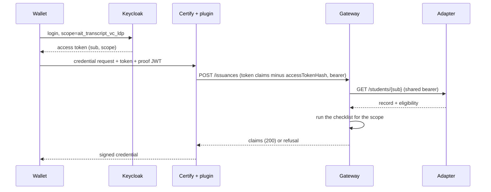

# Credential request

A credential request needs three things: an access token from the authorization server (Keycloak), a statement of what is requested (the scope), and a proof of the holder's key. The token carries who is asking (`sub`) and what it was granted (`scope`). The adapter never sees the wallet or the token.

For the endpoints and the full contracts see [Connecting a non-Inji OpenID4VCI wallet](../guides/other-openid4vci-wallets.md) and [Interface contracts](../project/issuer-v0.1/contracts.md); this page explains how the pieces fit.

## What the request carries

| Item | Where it comes from | What it decides |
|---|---|---|
| Access token | Keycloak, after the user logs in | Who is asking (`sub`) and what was granted (`scope`); Certify validates it |
| `scope` | Asked for by the wallet at login, granted by Keycloak (`ait_transcript_vc_ldp` is an optional client scope of `wallet-demo`) | Which credential type; the Gateway picks the type from it |
| `sub` | Keycloak mapper `sub-from-username` in `installations/ait/keycloak-realm.json`, so `sub` is the Keycloak username, for example `ait-2026-0001` | Whose record is read: the Gateway fetches the adapter's `/students/{sub}` |
| Proof JWT | The wallet, signed with its own key, identified as `did:jwk` | The holder id placed in the credential; it says which wallet receives it, not which student the data is about |

Identity is per degree: a student with two degrees has two Keycloak users and so two `sub` values (`ait-2026-0005` and `ait-2026-0005-phd` in the test realm).

## The token is signed, not encrypted

The access token is a JWT: `base64url(header).base64url(payload).signature`. Anyone holding it can read the payload by base64-decoding it; no key is needed. The payload is JSON, for example:

```json
{
  "iss": "http://keycloak:8080/realms/inji",
  "sub": "ait-2026-0001",
  "scope": "ait_transcript_vc_ldp",
  "client_id": "wallet-demo",
  "aud": ["wallet-demo"],
  "exp": 1790000000
}
```

`sub` and `scope` are separate top-level fields. Neither is secret; the signature makes them unforgeable.

## Signing and checking

Keycloak holds a private key per realm and never shares it. It signs the SHA-256 hash of `header.payload` with that key; the header names the key in `kid`. Certify holds only public keys, fetched from the realm's JWKS endpoint (`/realms/inji/protocol/openid-connect/certs`). It picks the key matching `kid`, verifies the signature, and also checks `iss` and `exp`. Any change to the payload, such as a different `sub`, breaks the signature.

Certify accepts tokens from exactly one issuer, and the token's `iss` is pinned to the Docker-internal `http://keycloak:8080/realms/inji` even though a browser reaches Keycloak at `localhost:9080`. This is why `issue_and_verify.py` must run inside the Docker network; see [Local stack](../architecture/vc-stack.md).

There are two signatures in the system and verifiers see only one. Keycloak signs the access token (who is logged in, which scope). Certify signs the credential with Ed25519Signature2020 (the issuer vouches for the claims). A verifier checks the credential's signature and never sees the access token.

## From token to claims



- Certify's data-provider plugin posts the token's claims to the Gateway's `POST /issuances`; the Gateway requires `sub` and `scope`. A token with no `sub` makes the plugin answer `invalid_access_token`.
- The Gateway picks the credential type from the first served scope inside `scope`. No match is `unknown_scope` (400).
- The Gateway fetches the record from the adapter with a shared bearer token between the two services. The adapter trusts the Gateway entirely and sees no wallet and no user token.
- The checklist (for example `on_roster`, `winner`) can refuse at issuance with `checklist_failed` (403). Registrar approval is not part of the token and is enforced in the demo app only; see [Approval gate](./approval-gate.md).

## What this means for a real adapter

`sub` selects the record, so the identity provider's `sub` must equal the adapter's record id, or the Gateway needs a mapping step. In the demo this holds because Keycloak's `sub` is mapped from the username, which equals the CSV `id`. Swapping the authorization server (eSignet, Authentik) must keep that equality and the `client_id` claim Certify requires; see contracts section 1.
