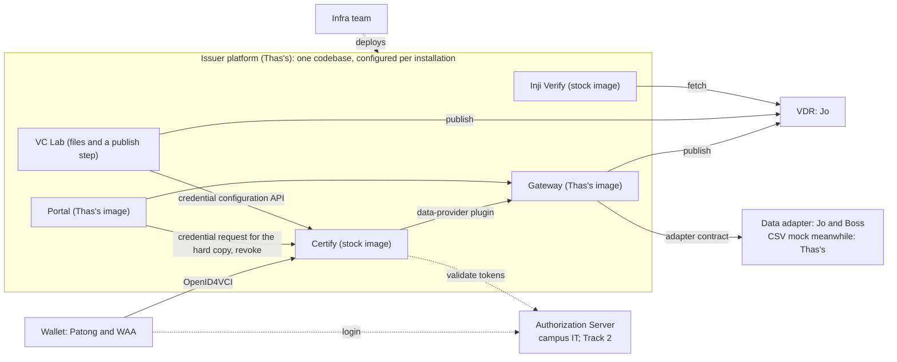

# Issuer platform responsibilities

Status: agreed on 2026-10-19, updated on 2026-10-20. Owner: Thas. What Thas, the Issuer platform owner, owns, what others own, and the decisions that draw that line. Vocabulary is in [`CONTEXT.md`](../../../CONTEXT.md), interfaces in [`contracts.md`](contracts.md), departures from PR 4 in [`deviations.md`](deviations.md).

## 1. Role

Thas owns the **Issuer platform**: one product, one codebase in `mosip-asia/ait-transcript`, deployed as two **installations** that differ only in configuration: AIT's academic transcript service and the sandbox hackathon. It plugs into other people's components under published standards: any OpenID4VCI wallet can claim from it, any organisation's records can feed it through an Adapter under the adapter contract, and any standards-conformant verifier can check what it issues. The Checklist and the VC Lab inside it promise no interoperability.

## 2. Who owns what

| Component | Thas's | Not Thas's | Counterpart |
|---|---|---|---|
| Gateway: data-provider plugin, checklist runner, admin API, mock VDR publisher | Code, image, configuration | | |
| Portal: staff side (search, revoke), student side (request, result, credential offer, hard-copy PDF in the student's own session) | Code, image, configuration | | |
| Certify 0.14, the signing engine | Configuration: credential configurations, plugin wiring, allowed audiences, status lists | The image, key custody | Infra team |
| Checklist, per credential type, evaluated at request time | The runner; the AIT and hackathon checklists as v0.1 content | The content in production | AIT registrar or OSA; hackathon organiser |
| VC Lab: PDF template, display metadata, JSON-LD template | Files, publish step, Certify configuration call | Any card template (none exists) | |
| Verifier: stock Inji Verify 0.17, co-deployed | Configuration; the hard-copy scan path | The image; verifiers third parties deploy | |
| Authorization Server: Keycloak for AIT in v0.1, eSignet for the hackathon | The Keycloak realm configuration; the OIDC contract (`contracts.md` section 1) | Campus directory federation; eSignet | Campus IT; Track 2 |
| Data adapter (`contracts.md` section 2b) | The contract; the CSV-backed mock | The real adapter against the SIS | Jo and Boss |
| VDR: DID document, status lists, templates, contexts | The mock publisher and its specification; the content | The host and the final publishing integration | Jo |
| Trusted-issuer list (VCGA) | Requesting registration; supplying the DID and schemas | Operating the list | Jo |
| Wallet: any OpenID4VCI holder | A valid credential offer; Inji Web and Mimoto only in the local Compose | The wallet | Patong and WAA |
| Deployment: CI/CD, Helm, environments, hostnames, GCP, Kubernetes | Triggering the pipeline; the configuration contract it deploys from | Everything else | Infra team |
| Signing key custody | Stating the requirement (PKCS12 or PKCS#11) | Custody | Infra team |

The hackathon's issuance page and policy service stay in `ait-vc`, outside the Issuer platform: the hackathon types are issued on roster predicates like the transcript.

## 3. What Thas delivers

- The Gateway and Portal images, and the [configuration contract](configuration-contract.md) for every stock image, ingress allowlist included (section 5); a change to it goes to the infra team first.
- A local Compose stack for development and integration tests, with Inji Web and Mimoto as test harness only.
- The VC Lab artifacts and their publish step; the credential design (versioned JSON-LD context, hardcoded schemas, the profile in section 6); the hackathon types on VCDM 2.0 before the 31 December dry run.
- The mock VDR publisher, which is the specification Jo builds against, and the CSV-backed mock Adapter.
- Documents: this one, `contracts.md`, `deviations.md`, and the end-to-end flow document planned in [`spec-part-2.md`](spec-part-2.md).

## 4. External contracts

**Jo (VDR and trusted-issuer list).** What is pushed (DID document, Bitstring status list, templates, JSON-LD contexts), where, and how often (the status list within Certify's 60-second batch, the rest on publish). Registering the Issuer in the trusted-issuer list comes before the first UAT issuance.

**Jo and Boss (data adapter).** `contracts.md` section 2b; Thas's CSV mock stands in until the real Adapter exists.

**Patong and WAA (wallet).** A valid OpenID4VCI credential offer, proven with stock Inji Web.

**Infra team.** The handover of section 3, plus two obligations Thas asks for rather than solves: stable public hostnames for the status list, DID document and context from the first real issuance, and signing-key custody.

**Track 4 successor.** The admin API.

## 5. Design decisions that bound the work

- **Instant decisions.** A request is decided when it is made. Human judgement lives in the organisation's data (a hold, a winner flag), never in a queue inside the Issuer platform.
- **Two check kinds.** A predicate over the record, or a required presentation; v0.1 uses predicates only.
- **The gate is in the Gateway.** The wallet runs the ordinary authorization-code flow; Certify calls the Gateway through the data-provider plugin; the Gateway runs the checklist and returns the record or refuses.
- **The Portal is the hard copy's wallet.** Inside the student's own sign-in, the Portal (a confidential client) takes the session's access token, signs a proof JWT with a Portal-held key and redeems the credential at Certify like any wallet, so the gate and the search row are unchanged. It puts the credential in the PDF's QR and stores nothing. No pre-authorized offer in v0.1: one Certify 0.14 instance cannot serve both pre-authorized offers and wallet-initiated issuance, so staff-triggered printing would take a second, hard-copy-only Certify ([`certify-preauth-flow.md`](../../reference/certify-preauth-flow.md)).
- **Hard-copy QR.** PixelPass (JSON, CBOR, zlib level 9, Base45) in the Portal, scan-tested against the Verify UI; numeric claims are strings; alphanumeric mode, at least 4 px per module.
- **Student page shows reasons for now.** A failed request shows the checklist reasons on the Portal's student side, a debugging aid to be masked later.
- **Signing coverage.** Top-level claim terms, `courses` as a JSON literal ([`transcript-context.md`](../../concepts/transcript-context.md)), checked by `vc-stack/smoke.sh`. The context URL is versioned (`/contexts/transcript/v1.json`); v1 may change in place during v0.1, after which every published version stays. The hashing method is a placeholder until an official design exists.
- **Rendering.** No embedded HTML claim and no card template: the Portal renders the PDF from the VC Lab template; wallets and the Verifier render from data.
- **No compatibility promise through v0.1.** Credentials issued in or before v0.1, the mid-December transcript included, may stop verifying when the context, hashing method or key changes.
- **One product, versioned configuration.** Nothing AIT-specific in code; hardcoded schemas are the one exception. An installation is one directory, `installations/<name>/`, and may need more than one Certify, which takes tokens from one issuer and serves one data-provider plugin.
- **Ingress allowlist is configuration.** Public: Certify's OpenID4VCI endpoints, Keycloak, the Portal, the Verify UI. Internal: Certify's management, ledger-search, status and credential-configuration APIs, which stock Certify leaves unauthenticated.

## 6. Verifier conformance profile

The public promise: anyone who deploys a verifier that follows this profile can verify an Issuer credential without asking the Issuer.

- W3C Verifiable Credentials Data Model 2.0, JSON-LD, for every credential configuration.
- Proof: Ed25519Signature2020 in v0.1, which Certify 0.14 and Inji Verify 0.17 support. Data Integrity 1.0 (`eddsa-rdfc-2022`) is the recorded deviation, to be revisited.
- Revocation: W3C Bitstring Status List v1.0, fetched from a public URL on the VDR.
- Issuer identifier: `did:web`, with the DID document on the VDR.
- Public URLs on the VDR for the JSON-LD context (versioned; after v0.1 every published version stays published), the status list and the DID document. Templates on the VDR serve the Portal, never a verifier.
- JSON-LD 1.1 processing: the context declares `courses` as a JSON literal (`@json`), so a verifier needs a JSON-LD 1.1 processor; jsonld-java is not one and rejects the context rather than dropping claims.
- Every claim in `credentialSubject` is covered by the signature.
- Not in the profile: selective disclosure, SD-JWT, offline verification.
- The profile may change at the PM's request.

## 7. Installations and environments

| | AIT transcript | Hackathon |
|---|---|---|
| Authorization server | Keycloak with campus directory federation (v0.1); Authentik the prime candidate after | Keycloak realm `hackathon`; eSignet from Track 2 if delivered by C6 |
| Data | SIS adapter (Jo and Boss), CSV mock meanwhile | A roster CSV through the same mock, one row per participant keyed by `sub` |
| Credential configurations | Academic transcript | Developer Passport, Achievement |
| Checklist | Predicates over holds, conferral, balance | Roster predicates: on the roster; `winner` |
| Hard copy | Portal-rendered PDF with QR | As configured |

Environments are the infra team's: Dev is live under `*.transcript-demo.ait-vc.dpi.ait.ac.th`; UAT is planned as the integration test bed with the other owners' components; Prod is a placeholder. Credentials issued in Dev and UAT are throwaway because their URLs encode the environment.

## 8. Out of scope

Everything in the "Not Thas's" column of section 2, plus: card rendering in any wallet; DMN, Windmill, BPMN and a checklist editing UI; PR 4's Milestone 2 authorization-server gate and deferred issuance; SD-JWT, selective disclosure, offline verification and the KMS choice.

## 9. Open items

- How the Gateway authenticates to several sources once the checklist has more than one; the intended shape is a service credential per source.
- Who owns the contract tests that prove the three external contracts in UAT.
- Whether Inji Web or Inji Mobile honour an externally hosted rendering template, which matters only if a card is ever wanted.
- Authentik as the Authorization Server after v0.1, and whether its flows and policies can host Checklist steps.
