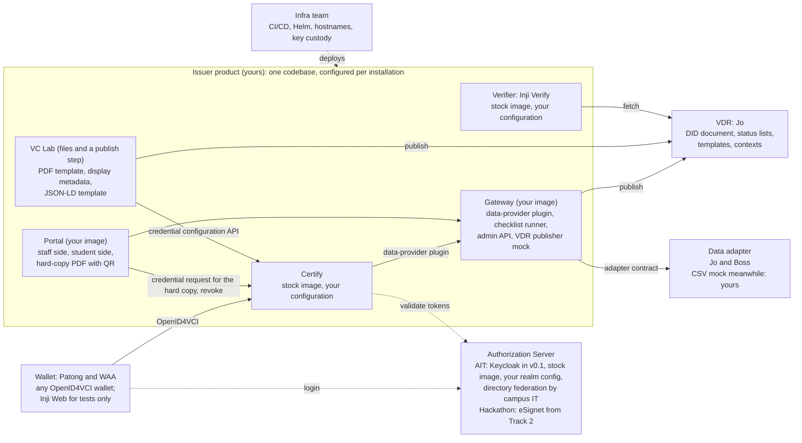

# Issuer responsibilities

Status: agreed on 2026-10-19; sections 2 to 10 updated on 2026-10-20 for the build decisions (context 1a, no hackathon chain, one stack per installation). Owner: thassung. This document says what the Issuer owner owns, what others own, and the decisions that draw that line; "the user", "you" and "yours" below mean the Issuer owner. It supersedes the scope section of the owner's 2026-10-11 scoping plan, which is kept outside this repository; "Q" numbers below refer to that plan's decision table. Vocabulary is in [`CONTEXT.md`](../../../CONTEXT.md). Interfaces are in [`contracts.md`](contracts.md). Departures from PR 4 are in [`deviations.md`](deviations.md).

## 1. Role

The user owns the **Issuer**: one product, one codebase in `mosip-asia/ait-transcript`, deployed as two **installations** that differ only in configuration: AIT's academic transcript service and the sandbox hackathon. The Issuer is a module meant to be plugged into other people's components in different versions under published standards: any OpenID4VCI wallet can claim from it, any data source can feed it through the adapter contract, and any standards-conformant verifier can check what it issues. Inside the Issuer, the Checklist and the VC Lab may be separate containers but carry no interoperability promise toward other vendors.

The user's track assignment does not change, but the substance of the work moves toward Track 3's ground (issuance, status lists, the publishing interface to the VDR). The wallet, formerly part of the user's Track 4 scope, is owned by Patong and WAA.

## 2. Who owns what

| Component | What it is | Yours | Not yours | Counterpart |
|---|---|---|---|---|
| Gateway | Your service around Certify: the REST data-provider plugin for Certify 0.14, the checklist runner, the admin API, the mock VDR publisher | Code, image, configuration | | |
| Portal | The FastAPI application, evolved from the demo's registrar portal. Staff side: search, revoke. Student side: request, result, credential offer, PDF download (the hard copy, made in the student's own session; staff print is out of v0.1, 2026-10-20) | Code, image, configuration | | |
| Certify | Inji Certify 0.14, the signing engine | Configuration: credential configurations, plugin wiring, allowed audiences, status-list settings | The image, the key custody | Infra for custody |
| Checklist | The per-credential-type list of checks, evaluated instantly at request time | The mechanism and the runner; the AIT and hackathon checklist files as v0.1 content | The content in production, which the organisation that holds the data maintains | AIT registrar or OSA; hackathon organiser |
| VC Lab | Template authoring and publishing: the printable PDF template, the issuer display metadata (name, logo link, colours), the JSON-LD credential template | Files, publish step, Certify configuration call | Any card template (none exists) | |
| Verifier | Stock Inji Verify 0.17, service and UI, co-deployed with the Issuer | Configuration and the proven hard-copy scan path | The image, and any verifier a third party deploys | |
| Authorization Server | Keycloak (stock image) for AIT in v0.1, there only to have authentication in place; eSignet from Track 2 for the hackathon | The Keycloak realm configuration and the OIDC contract (`contracts.md` section 1) | Directory federation on the campus side; eSignet itself | Campus IT; Track 2 |
| Data adapter | The REST service that serves records and eligibility attributes under `contracts.md` section 2b | The contract; the CSV-backed mock that implements it in dev | The real adapter against the SIS | Jo and Boss |
| VDR | The public host for the DID document, status lists, templates and JSON-LD contexts | The mock publisher and its specification; the content | The host and the final publishing integration | Jo |
| Trusted-issuer list (VCGA) | Where verifiers learn which issuers to trust | Requesting registration and supplying the DID and schemas | Operating the list | Jo |
| Wallet | Any OpenID4VCI-conformant holder | Nothing beyond a valid credential offer; Inji Web and Mimoto run only in the local Compose for integration tests | The wallet | Patong and WAA |
| Deployment | CI/CD, Helm charts, pipelines, environments, hostnames, GCP and Kubernetes | Triggering the provided pipeline; the configuration contract it deploys from | Everything else, end to end | Infra team |
| Signing key custody | Where Certify's key lives in each environment | Stating the requirement (Certify supports PKCS12 or PKCS#11) | Custody | Infra team |
| Hackathon issuance page and policy service | Hackathon code in `ait-vc` that chains OpenID4VP and OpenID4VCI | Nothing: the chain is not carried into the Issuer (2026-10-20); Developer Passport and Achievement are issued on roster predicates like the transcript | The `ait-vc` code, left as it is | — |

## 3. What you deliver

- Two images you own: the Gateway and the Portal.
- The configuration contract for every stock image: environment variables, mounted configuration files, per-installation settings, and the ingress allowlist (section 5). Any change to it goes to the infra team before it is applied.
- A local Compose file for development and integration tests, including Inji Web and Mimoto as test harness only.
- The VC Lab artifacts: the PDF template, the display metadata, the JSON-LD credential template, and the publish step that places them.
- The credential design: the versioned JSON-LD context (transcript only; no Student ID in v0.1, decided 2026-10-20), the hardcoded credential schemas, and the conformance profile (section 6).
- The mock VDR publisher, which is also the specification Jo builds the final publisher against.
- The CSV-backed mock adapter that implements the adapter contract including the eligibility attributes, editable so the checklist can be exercised.
- The hackathon configuration set (Developer Passport, Achievement; the VPID and the chain were dropped on 2026-10-20) migrated to VCDM 2.0 and installed in the Issuer before the 31 December dry run.
- Documents: this one; `ISSUER_E2E_FLOWS.md` (section 4, Jo); `contracts.md`; `deviations.md`.
- Contract tests for the three external contracts, if ownership lands with you (section 9).

## 4. External contracts

Each counterpart gets one written contract and, before the handover to Jo, the end-to-end flow document: `ISSUER_E2E_FLOWS.md` (not yet written), one sequence diagram per flow (wallet-initiated issuance through the authorization server, Portal-initiated hard copy, revocation and publish, verification) with a table of every secret, token, key and signature per hop.

**Jo (VDR and trusted-issuer list).** The publishing contract states what is pushed (DID document, Bitstring status list, templates, JSON-LD contexts), where, and how often (status list on change, within Certify's 60-second batch; the rest on publish). Its mock is yours and is the specification. Registration of the Issuer, its DID and its schemas in the trusted-issuer list is a checklist item before the first UAT issuance.

**Jo and Boss (data adapter).** `contracts.md` section 2b, extended with the eligibility attributes the checklist reads (holds, conferral status, balance). Until the real adapter exists, your CSV mock stands in; the approval queue does not.

**Patong and WAA (wallet).** The promise is a valid OpenID4VCI credential offer and nothing more. Issuance is proven in CI with stock Inji Web.

**Infra team.** The handover artifact of section 3. Two obligations move to infra and are yours to ask for, not to solve: stable public hostnames for the status-list URL, the DID document and the JSON-LD context from the first real issuance (Dev and UAT credentials stay throwaway because their URLs encode the environment), and signing-key custody.

**Track 4 successor.** The admin API. Since the hackathon chain is dropped (2026-10-20), nothing delegates to the policy service in v0.1 and the issuance page is not re-pointed; the successor is no longer on the hackathon's critical path.

## 5. Design decisions that bound the work

- **Instant decisions.** A credential request is decided when it is made, pass or fail. Human judgement lives in the data the organisation maintains (a hold, a winner flag), never in a queue inside the Issuer. The Portal's approve and reject queue is removed in v0.1.
- **Two check kinds.** A check is a predicate over the record or a required presentation. v0.1 has one predicate source, the adapter, and exercises predicates only; the presentation kind stays defined and is used by nothing in v0.1 (2026-10-20).
- **The gate is in the Gateway.** For wallet-initiated issuance the wallet runs the ordinary authorization-code flow; Certify calls the Gateway through the data-provider plugin; the Gateway evaluates the checklist and returns the record or refuses. Plan Q23 stands.
- **The Portal is the hard copy's wallet.** A hard copy is made from the student side, inside the student's own sign-in: the Portal, a confidential client of the Authorization Server, takes that session's access token (credential scope, Certify audience), signs a proof JWT with a Portal-held key and redeems the credential at Certify's issuance endpoint as any wallet does, so the gate and the search row are the plugin path's, unchanged. It embeds the bearer credential in the PDF's QR and then discards it; the Portal never stores a credential, the ledger keeps identifiers only. No pre-authorized code in v0.1: Certify 0.14 serves pre-authorized offers and wallet-initiated issuance from separate instances (one data-provider plugin, one token issuer per instance), so staff-triggered printing is out of v0.1 and, if OSA asks for it, is added as a second hard-copy-only Certify instance with pre-authorized offers (research `certify-preauth-flow.md`). PR 4's Milestone 2 authorization-server gate and deferred issuance are not needed (2026-10-20).
- **Hard-copy QR.** The PixelPass pipeline (JSON, CBOR, zlib level 9, Base45) implemented in Python inside the Portal, with a scan test against the Verify UI in CI. Two rules follow: numeric claims are strings, and the QR is drawn in alphanumeric mode at a size giving at least 4 px per module on the page.
- **Student page shows reasons for now.** A failed request shows the checklist result with reasons on the Portal's student side as a debugging aid; it is expected to be masked later.
- **VCDM 2.0 for every configuration.** The hackathon types migrate from VCDM 1.1 and gain status lists.
- **Signing coverage fixed in v0.1.** The context fix is option 1a of research 07: claim terms at the top level, `courses` as a JSON literal, tried against Certify 0.14 first with option 1b (ten inner terms defined) as the fallback. 1a was confirmed on 2026-10-20, gated on the Compose check in `wiki/research/certify-json-literal.md`. The context URL is versioned from day one (`/contexts/transcript/v1.json`); in v0.1, v1 may be edited in place, and once credentials must survive a change, which is after v0.1, every published version stays published and a change takes a new number; 1b is the planned v2 context for when selective disclosure is scheduled, which also needs a selective-disclosure cryptosuite, a Certify release that signs with it, and wallet support. Course objects keep the shape 1b will define: ordered arrays, the same ten keys, numbers as strings. The hashing method itself is a placeholder: today Certify and the Verifier hash only one level down of the nested JSON-LD, and the final method follows the official design when one exists, not our choice.
- **No embedded HTML claim.** The HTML course table claim leaves the credential with the context fix. The Portal renders the PDF from the VC Lab template on the VDR; wallets and the Verifier render from data. The Verifier keeps rendering as it does today and never fetches a template from the VDR; templates on the VDR exist for the Portal only.
- **No card template.** Wallets draw their own card from the display metadata and the claims. An SVG rendering template is a recorded option, gated on a spike showing that Inji Web or Inji Mobile honours it.
- **No compatibility promise through v0.1.** Credentials issued in or before v0.1, including the transcript issued in mid-December, may stop verifying when the context, the hashing method or the signing key changes. That is accepted.
- **Authorization Server product.** Keycloak is in v0.1 only to satisfy the need for authentication. The prime candidate for the final product is Authentik (open source), which may satisfy authentication and also host Checklist steps through its flows and policies.
- **Proof suite.** Ed25519Signature2020 for v0.1, because Certify 0.14 and Inji Verify 0.17 support it today; the W3C Data Integrity 1.0 suite is the recorded deviation.
- **One product, versioned configuration.** Nothing AIT-specific in code paths; AIT lives in configuration. "Hardcode schema for now" is the one admitted exception, covering the transcript and the two hackathon types. An installation is a self-contained stack (its own Certify, Postgres, Gateway, adapter, Portal, Verify) described by one directory, `installations/<name>/`, mounted by one Compose file; it may hold more than one Certify instance, because Certify 0.14 takes tokens from one issuer and serves one data-provider plugin (2026-10-20).
- **Ingress allowlist is configuration.** Public: Certify's OpenID4VCI endpoints, Keycloak, the Portal, the Verify UI. Internal only: Certify's management, ledger-search, status and credential-configuration APIs, called by the Gateway and Portal. Stock Certify leaves those unauthenticated, so the allowlist is part of what infra deploys from.

## 6. Verifier conformance profile

The public promise: anyone who deploys a verifier that follows this profile can verify an Issuer credential without asking the Issuer.

- W3C Verifiable Credentials Data Model 2.0, JSON-LD.
- Proof: Ed25519Signature2020 in v0.1. Data Integrity 1.0 (`eddsa-rdfc-2022`) is the recorded deviation, to be revisited.
- Revocation: W3C Bitstring Status List v1.0, fetched from a public URL on the VDR.
- Issuer identifier: `did:web`, with the DID document on the VDR.
- Public URLs on the VDR for the JSON-LD context (versioned from day one; after v0.1 every published version stays published), the status list and the DID document. Templates on the VDR serve the Portal, never a verifier.
- JSON-LD 1.1 processing: the context declares `courses` as a JSON literal (`@json`), so a verifier needs a JSON-LD 1.1 processor; jsonld-java is not one and rejects the context rather than dropping claims.
- Every claim in `credentialSubject` is covered by the signature (after the v0.1 context fix; the hashing method is a placeholder until an official design exists).
- Not in the profile: selective disclosure, SD-JWT, offline verification.
- The profile may change at the PM's request.

## 7. Installations and environments

| | AIT transcript | Hackathon |
|---|---|---|
| Authorization server | Keycloak with campus directory federation (v0.1); Authentik the prime candidate after | Keycloak realm `hackathon` by default; eSignet from Track 2 is the one-line swap if it is delivered by C6 |
| Data | SIS adapter (Jo and Boss), CSV mock meanwhile | The roster as a CSV through the same mock adapter, one row per participant keyed by `sub` |
| Credential configurations | Academic transcript | Developer Passport, Achievement, VCDM 2.0; the VPID and the chain dropped (2026-10-20) |
| Checklist | Predicates over holds, conferral, balance | Roster predicates: on the roster; `winner` |
| Hard copy | Portal-rendered PDF with QR | As configured |

Environments are the infra team's: Dev is live with stable URLs under `*.transcript-demo.ait-vc.dpi.ait.ac.th`, with Certify, Mimoto, Verify and the Keycloak realms behind one API gateway host; UAT is planned as the integration test bed with the other owners' components; Prod is a placeholder. Credentials issued in Dev and UAT are throwaway because their URLs encode the environment, and credentials issued in or before v0.1, including the mid-December transcript, carry no compatibility promise either. Plan Q28, the registry hostname, is resolved for Dev.

## 8. Out of scope

- The VDR, the trusted-issuer list and their operation (Jo).
- The web wallet as a deliverable (Patong and WAA); Inji Web and Mimoto run only for integration tests.
- Card rendering in any wallet.
- The real SIS integration and the production adapter (Jo and Boss).
- Deployment, Helm charts, pipelines, hostnames, environments and key custody (infra team).
- DMN, Windmill, BPMN, a checklist editing UI.
- PR 4's Milestone 2 authorization-server gate and deferred issuance.
- SD-JWT and selective disclosure; offline verification; the KMS choice.
- The hackathon's issuance page and policy service: the chain is not carried into the Issuer (2026-10-20), so nothing is re-pointed.

## 9. Open items

- How the Gateway authenticates to several sources once the checklist has more than one; the intended shape is a service credential per source, decided nothing yet.
- Who owns the contract tests that prove the three external contracts in UAT.
- Whether Inji Web or Inji Mobile honour an externally hosted rendering template, which matters only if a card is ever wanted.
- Authentik as the Authorization Server after v0.1, and whether its flows and policies can host Checklist steps.

## 10. Decision log

| Date | Decision | Status on 2026-10-19 |
|---|---|---|
| 2026-09-28 | `ait-vc` is the home repository and absorbs the demo | Superseded: `mosip-asia/ait-transcript` is the Issuer product repository |
| 2026-10-01 | Signing coverage is a known issue, do not fix without go-ahead | Reversed: fixed in v0.1 with context option 1a, because of the verifier promise |
| 2026-10-05 | PR 4 adopted by the team; comply unless a critical or high problem is found | Stands; the two critical points (a separate Authorization Server, product-neutral with Keycloak as the v0.1 choice; enforcement at the credential endpoint) go to PR 4 as review comments, not file edits (2026-10-19) |
| 2026-10-11 Q1/Q14 | We own the issuing engine and the public registry | Superseded: we own the Issuer product; the VDR is Jo's |
| 2026-10-11 Q6 | Wallet and walletless claims through the stock catalog | Superseded: bring your own wallet; the Portal renders the hard copy |
| 2026-10-11 Q7, Q22 | Registry host caches the status list; static `did.json` on our registry host | Superseded: published to Jo's VDR through our mock publisher |
| 2026-10-11 Q13 | A colleague owns deployment | Superseded: the infra team owns deployment end to end |
| 2026-10-11 Q17, Q19 | Admin portal not ours; Windmill left to the portal owner | Superseded: the Portal is ours; no Windmill or DMN |
| 2026-10-11 Q23 | Approval gate in the gateway the plugin calls | Stands |
| 2026-10-11 Q28 | Registry hostname to be asked | Resolved for Dev |
| 2026-10-19 | PR 4 Milestone 2 authorization-server gate and deferred issuance | Not needed: decisions are instant |
| 2026-10-19 | Wallet PWA ownership | Patong and WAA |
| 2026-10-19 | Keycloak serves v0.1 authentication only; Authentik is the prime candidate for the final product | Recorded |
| 2026-10-19 | Credentials issued through v0.1, the mid-December transcript included, may break on later changes | Accepted |
| 2026-10-19 | The Verifier renders as today and uses no VDR template | Recorded |
| 2026-10-19 | The context fix is a placeholder; the hashing method follows the official design when one exists | Recorded |
| 2026-10-20 | Context option 1a confirmed from source (Titanium JSON-LD 1.1 on both paths), gated on a Compose check; context URL versioned from day one; no Student ID credential in v0.1 | Recorded |
| 2026-10-20 | The hackathon chain (VPID, presentation check, policy service) is dropped; two types on roster predicates; Keycloak realm by default | Recorded |
| 2026-10-20 | One stack per installation, one directory each; a Certify 0.14 instance serves one token issuer and one data-provider plugin, so an installation may hold several | Recorded |
